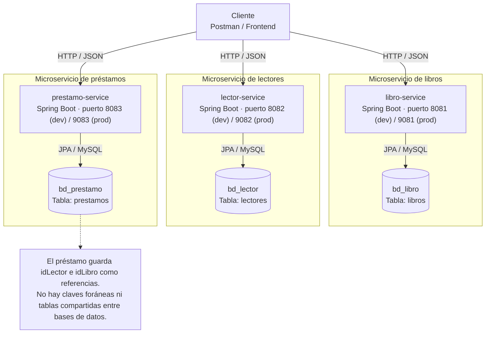

# Evaluación 03 - Laboratorio 03: Sistema de Biblioteca

**Estudiante:** José Manuel Barzola Veliz  
**Curso:** Desarrollo de Aplicaciones Web - Microservicios  
**Fecha:** noviembre 2026

Sistema de biblioteca compuesto por **3 microservicios independientes**, cada uno con su propia base de datos y su propio puerto.

---

## 1. Requisitos

| Requisito | Versión |
|---|---|
| Java (JDK) | 17 o superior |
| Maven | 3.9+ |
| MySQL (XAMPP) | 8 / MariaDB 10+ |
| Spring Boot | 4.1.2 |

## 2. Microservicios, puertos y bases de datos

| Microservicio | Puerto (dev) | Puerto (prod) | Base de datos | Responsabilidad |
|---|---|---|---|---|
| `libro-service` | **8081** | 9081 | `bd_libro` | Catálogo de libros (ISBN, título, autor, stock, estado) |
| `lector-service` | **8082** | 9082 | `bd_lector` | Registro de lectores (documento, nombres, contacto) |
| `prestamo-service` | **8083** | 9083 | `bd_prestamo` | Préstamos y devoluciones (referencias por ID) |

> **Clave de la arquitectura:** cada microservicio tiene **su propia base de datos**.  
> Los préstamos se relacionan con lectores y libros **solo por ID** (`idLector`, `idLibro`), sin compartir tablas.

## 3. Pasos de ejecución

### 3.1 Base de datos

Las bases `bd_libro`, `bd_lector` y `bd_prestamo` ya están creadas. Inicia **MySQL** desde XAMPP. Si necesitas crear alguna base que falte, ejecuta el script incluido; `IF NOT EXISTS` conserva las bases existentes y sus datos:

```bash
mysql -u root < script-biblioteca.sql
```

También puedes pegar el contenido de `script-biblioteca.sql` en phpMyAdmin → pestaña SQL. Al iniciar cada servicio, JPA crea o actualiza sus tablas.

### 3.2 Levantar los microservicios

Abrir **3 terminales** (una por servicio) y ejecutar en cada carpeta:

```bash
# Terminal 1 - Libros (puerto 8081)
cd libro-service
mvn spring-boot:run

# Terminal 2 - Lectores (puerto 8082)
cd lector-service
mvn spring-boot:run

# Terminal 3 - Préstamos (puerto 8083)
cd prestamo-service
mvn spring-boot:run
```

Verificación rápida:

```bash
curl http://localhost:8081/api/libros
curl http://localhost:8082/api/lectores
curl http://localhost:8083/api/prestamos
```

### 3.3 Perfiles dev / prod

El perfil activo por defecto se define en `application.yml`; usa los puertos dev 8081, 8082 y 8083. Para producción, inicia con `--spring.profiles.active=prod`; los puertos serán 9081, 9082 y 9083.

```yaml
spring:
  profiles:
    active: dev      # cambiar a prod para producción
```

| Valor | `dev` | `prod` |
|---|---|---|
| Puerto servidor | 8081 / 8082 / 8083 | 9081 / 9082 / 9083 |
| Host MySQL | `localhost` | variable de entorno `DB_HOST` |
| `show-sql` | `true` (muestra SQL en consola) | `false` |
| Ambiente | `desarrollo` | `produccion` |

La conexión se configura con las variables de entorno `DB_USER`, `DB_PASSWORD` y `DB_HOST`. En desarrollo, por defecto se usa MySQL local de XAMPP con usuario `root` y contraseña vacía. Para producción, configura credenciales propias. `DB_HOST` debe ser solo el nombre o IP del servidor, sin `:3306`.

## 4. Endpoints

### libro-service (`http://localhost:8081`)

| Método | Ruta | Descripción |
|---|---|---|
| GET | `/api/libros` | Listar todos los libros |
| GET | `/api/libros/{id}` | Buscar libro por ID |
| GET | `/api/libros/isbn/{isbn}` | Buscar libro por ISBN |
| POST | `/api/libros` | Registrar libro (201 Created) |
| PUT | `/api/libros/{id}` | Actualizar libro completo |
| DELETE | `/api/libros/{id}` | Eliminar libro (204 No Content) |

**Ejemplo POST:**
```json
{
  "isbn": "978-84-376-0494-7",
  "titulo": "Cien años de soledad",
  "autor": "Gabriel García Márquez",
  "stock": 5
}
```

### lector-service (`http://localhost:8082`)

| Método | Ruta | Descripción |
|---|---|---|
| GET | `/api/lectores` | Listar todos los lectores |
| GET | `/api/lectores/{id}` | Buscar lector por ID |
| GET | `/api/lectores/documento/{doc}` | Buscar lector por documento |
| POST | `/api/lectores` | Registrar lector (201 Created) |
| PUT | `/api/lectores/{id}` | Actualizar lector completo |
| DELETE | `/api/lectores/{id}` | Eliminar lector (204 No Content) |

**Ejemplo POST:**
```json
{
  "documento": "72345678",
  "nombres": "Juan Carlos",
  "apellidos": "Pérez López",
  "correo": "juan.perez@mail.com",
  "telefono": "987654321"
}
```

### prestamo-service (`http://localhost:8083`)

| Método | Ruta | Descripción |
|---|---|---|
| GET | `/api/prestamos` | Listar todos los préstamos |
| GET | `/api/prestamos/{id}` | Buscar préstamo por ID |
| GET | `/api/prestamos/lector/{idLector}` | Préstamos de un lector |
| GET | `/api/prestamos/estado/{estado}` | Filtrar por ACTIVO / DEVUELTO / VENCIDO |
| POST | `/api/prestamos` | Registrar préstamo (201 Created) |
| PATCH | `/api/prestamos/{id}/devolucion` | **Devolver el libro** (cambia estado a DEVUELTO) |
| DELETE | `/api/prestamos/{id}` | Eliminar préstamo (204 No Content) |

**Ejemplo POST (préstamo):**
```json
{
  "idLector": 1,
  "idLibro": 1,
  "fechaPrestamo": "2026-11-03",
  "fechaLimite": "2026-11-17"
}
```

## 5. Respuestas de error (manejo global)

Cada microservicio tiene un `@RestControllerAdvice` (`ManejoGlobalErrores`) que devuelve JSON con mensaje claro:

| Código | Cuándo ocurre | Ejemplo de mensaje |
|---|---|---|
| **400** | Datos inválidos (DTO con `@Valid`) | `"campos": {"titulo": "El título es obligatorio"}` |
| **400** | Regla de negocio violada | `"La fecha límite debe ser posterior a la fecha de préstamo"` |
| **404** | ID inexistente | `"Libro con id 99 no existe"` |
| **409** | Dato único duplicado | `"Ya existe un libro con ISBN 978..."` |
| **409** | Devolución repetida | `"El préstamo con id 1 ya fue devuelto"` |

**Ejemplo de respuesta 404:**
```json
{
  "timestamp": "2026-11-03T10:15:00",
  "status": 404,
  "error": "Not Found",
  "mensaje": "Libro con id 99 no existe"
}
```

## 6. Reglas de negocio implementadas

1. **ISBN y documento únicos:** no se permite registrar duplicados (409).
2. **Stock no negativo:** validado con `@Min(0)` en el DTO (400).
3. **Estado del libro:** si se envía `INACTIVO`, se conserva; en otro caso, stock = 0 → `AGOTADO` y stock > 0 → `DISPONIBLE`.
4. **Fechas del préstamo:** la fecha límite debe ser **posterior** a la fecha de préstamo (400).
5. **Devolución:** solo cambia el estado a `DEVUELTO`; si ya fue devuelto → 409.

## 7. Estructura de código (cada microservicio)

```
src/main/java/com/biblioteca/xxx_service/
├── model/        → Entidades JPA (Libro, Lector, Prestamo) + enums
├── dto/          → DTOs de entrada con validaciones (@NotBlank, @Min...)
├── repository/   → Interfaces JpaRepository + consultas personalizadas
├── services/     → Lógica de negocio y reglas
├── controller/   → Endpoints REST
└── exception/    → Excepciones de negocio + ManejoGlobalErrores
```

`src/main/resources/`
```
application.yml        → Perfil activo por defecto (dev)
application-dev.yml    → Configuración de desarrollo
application-prod.yml   → Configuración de producción
```

## 8. Diagrama de microservicios y bases de datos

El cliente (Postman o el frontend) consume cada API REST por separado. Cada microservicio administra exclusivamente su propia base de datos:


## 9. Evidencias (Postman)

**Pendiente de completar al final:** guarda aquí capturas de Postman o exporta una colección. La carpeta todavía no contiene esas evidencias. Deben mostrar:
- Casos exitosos: GET, POST (201), PUT, DELETE (204), PATCH devolución.
- Casos fallidos: 400 (datos inválidos), 404 (ID inexistente), 409 (duplicado).

## 10. Conclusiones

1. **Separación por responsabilidad:** dividir la biblioteca en libros, lectores y préstamos permite cambiar un servicio sin tocar los demás y refleja dominios reales del negocio.
2. **Cada servicio con su propia BD:** elimina el acoplamiento entre tablas y obliga a comunicarse por API; el costo es no poder usar foreign keys entre servicios, por lo que la integridad se valida en la lógica de negocio.
3. **Spring Data JPA simplifica el CRUD:** con `JpaRepository` se obtiene el CRUD completo y las consultas personalizadas (`findByIsbn`, `findByIdLector`) sin escribir SQL.
4. **Los DTO + validaciones protegen la API:** validar en la entrada (`@NotBlank`, `@Min`, `@Email`) evita datos corruptos y devuelve errores claros al cliente con el `@RestControllerAdvice`.
5. **Los estados como enum aportan seguridad:** usar `EstadoLibro` y `EstadoPrestamo` evita valores inválidos y hace explícito el ciclo de vida (ACTIVO → DEVUELTO).

**Dificultad encontrada y solución:**  
Al inicio, el manejo de errores devolvía el mensaje en texto plano y no en JSON, lo que complicaba leer las respuestas fallidas en Postman. Se resolvió creando una clase `ErrorRespuesta` y un `ManejoGlobalErrores` con `@RestControllerAdvice`, de modo que todos los errores (400, 404, 409) devuelven el mismo formato JSON con `timestamp`, `status` y `mensaje`.


